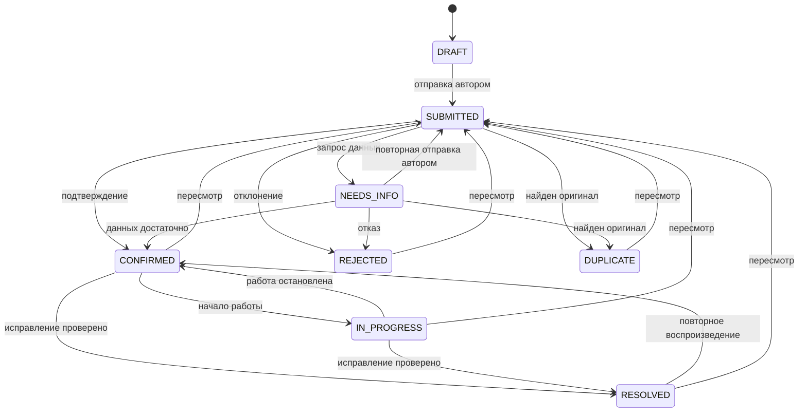
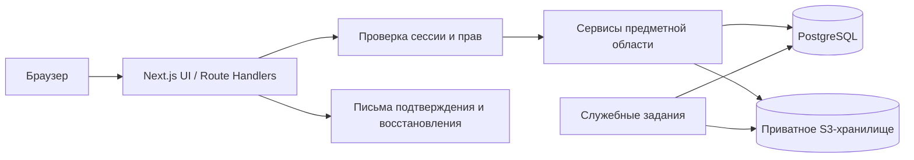

# BugTrail

**Платформа для поиска, проверки и отслеживания ошибок в программных проектах.**

[Открыть демо](https://bugtrail-two.vercel.app) · [Репозиторий](https://github.com/arcnosixta/BugTrail) · [Проверки main](https://github.com/arcnosixta/BugTrail/actions/workflows/checks.yml)

README и техническое задание • версия 1.0 • 5 ноября 2026 года • язык интерфейса: русский.

> **Порядок работы:** сначала это ТЗ, затем основа Next.js и frontend с синтетическими демоданными. Настоящие backend, база данных, авторизация и инфраструктура — последующий этап. Разделы 4, 6–7 и 9–13 описывают целевую полную версию; клиентское демо не обеспечивает серверных прав и сохранности данных. Фактическое состояние frontend описано в блоке запуска ниже.


## Запуск текущей версии

Сейчас реализован **frontend с локальными демонстрационными данными**: 4 проекта, 15 отчётов, 6 участников и отдельные профили пользователя, модератора и администратора.

Требуется Node.js 24.x и npm. Из корня проекта:

```powershell
npm ci
npm run dev
```

Откройте `http://localhost:3000`. Для проверки используйте `npm run lint`, `npm run typecheck` и `npm run build`; production-сборка запускается командой `npm run start`. Переменные окружения для этой версии не нужны.

Работают каталог, обзор, поиск/фильтры, создание и сохранение отчётов, уточнения, обсуждения, история, модерация, уровни/рейтинг, уведомления и административные формы. Сценарии выбираются переключателем профиля в верхней панели. Сброс исходного набора — в настройках.

**Ограничения текущего этапа:**

- Все изменения хранятся в `localStorage` этого браузера и этого адреса сайта. Очистка данных браузера удаляет изменения; между устройствами данные не синхронизируются.
- Изображения доступны как локальный предпросмотр в текущей вкладке; после её перезагрузки их может потребоваться выбрать заново.
- Вход, регистрация и письма — демонстрационные сценарии. Пароли не сохраняются и никуда не отправляются.
- Переключение профилей и ограничения кнопок показывают будущий интерфейс; это не настоящая авторизация.
- Баллы вычисляются по текущему состоянию демоотчётов. Неизменяемый серверный журнал, транзакции, лимиты и другие гарантии из ТЗ ещё предстоит реализовать.
- При недоступном хранилище интерфейс предупреждает, что изменения действуют до обновления страницы.

Используемые версии: Next.js 16.4.5, React 19.3.0, Tailwind CSS 4.3.4, TypeScript. Для запуска и сборки выбран Webpack с официальным PostCSS-плагином Tailwind. Точные версии остальных пакетов закреплены в `package-lock.json`.

### Проверка frontend

В конечной папке проекта прошли `npm run lint -- --max-warnings=0`, `npm run typecheck` и `npm run build`. Собранная версия запускалась через `npm run start` и проверена в Edge:

- Основные маршруты, страницы трёх профилей, поиск и мобильная навигация.
- Создание отчёта, запрос уточнений и повторная отправка.
- Подтверждение, работа над исправлением, повторное открытие, пересмотр и дубликат.
- Баланс 20 → 30 → 30 → 20 при подтверждении, повторном открытии и отмене награды; комментарий баллы не меняет.
- Сохранение после обновления и восстановление 15 исходных отчётов кнопкой сброса.
- Обзор, список, форма, карточка и каталог при ширинах 360, 768, 1280 и 1440 px без горизонтального скролла страницы.

Ошибок JavaScript при обходе основных маршрутов не обнаружено. Показатели Lighthouse и нагрузочные цели раздела 14 пока не измерялись.

### Публикация и проверки зависимостей

Frontend опубликован на [Vercel](https://bugtrail-two.vercel.app). Репозиторий [arcnosixta/BugTrail](https://github.com/arcnosixta/BugTrail) публичный, основная ветка — `main`. Workflow `.github/workflows/checks.yml` проверяет установку зависимостей, lint, TypeScript и production-сборку на Node.js 24. Для Vercel заданы Next.js preset и команды в `vercel.json`; `.vercelignore` исключает локальные кэши и артефакты из загрузки.

Проверка `npm audit --omit=dev` не выявила уязвимостей runtime-зависимостей. Полный audit показывает 8 предупреждений moderate в dev-цепочке ESLint → typescript-eslint → minimatch; они относятся к [GHSA-g3hv-75wg-m249](https://github.com/advisories/GHSA-g3hv-75wg-m249). Совместимого исправления в текущих диапазонах пока нет; принудительный переход minimatch на другую major-версию не применялся. Это ограничение инструментов разработки, которое следует пересмотреть при обновлении зависимостей.

### Запуск на Windows

`scripts/next.mjs` запускает Next.js и подключает на Windows модуль `scripts/windows-fs-compat.mjs`. Он обрабатывает случай, когда дополнительный диск возвращает `EISDIR` при `readlink` обычного файла: после проверки `lstat` ошибка нормализуется в `EINVAL`. Реальные символические ссылки и другие ошибки сохраняют стандартное поведение. Этот случай обсуждается в [репозитории Next.js](https://github.com/vercel/next.js/issues/45067). На Linux, включая обычную среду сборки Vercel, модуль совместимости не подключается.


Текущие исходники разделены на `src/components` (оболочка и общие элементы), `src/features` (группы страниц) и `src/demo` (типы, данные и локальное состояние). Страницы подключаются в App Router через `src/app/[[...path]]/page.tsx`. Разделы ниже задают требования к полной версии; они не означают наличие backend в текущей поставке.


## Содержание

1. [Идея и цели](#1-идея-и-цели)
2. [Зафиксированные решения и допущения](#2-зафиксированные-решения-и-допущения)
3. [Границы MVP](#3-границы-mvp)
4. [Роли и серверные права](#4-роли-и-серверные-права)
5. [Пользовательские сценарии](#5-пользовательские-сценарии)
6. [Жизненный цикл отчёта](#6-жизненный-цикл-отчёта)
7. [Геймификация и защита от накруток](#7-геймификация-и-защита-от-накруток)
8. [Дизайн и интерфейс](#8-дизайн-и-интерфейс)
9. [Архитектура и стек](#9-архитектура-и-стек)
10. [Модель данных](#10-модель-данных)
11. [API и договорённости](#11-api-и-договорённости)
12. [Валидация](#12-валидация)
13. [Безопасность и приватность](#13-безопасность-и-приватность)
14. [Нефункциональные требования](#14-нефункциональные-требования)
15. [Проверки и критерии приёмки](#15-проверки-и-критерии-приёмки)
16. [Этапы реализации](#16-этапы-реализации)
17. [Будущая структура и запуск](#17-будущая-структура-и-запуск)
18. [Вопросы для согласования](#18-вопросы-для-согласования)
19. [Референсы и документация](#19-референсы-и-документация)

## 1. Идея и цели

BugTrail связывает людей, находящих ошибки, с командами, которые могут проверить и исправить их. Пользователь выбирает проект, описывает проблему, прикладывает изображения и получает понятный ответ о результате проверки. Модератор воспроизводит проблему, запрашивает недостающую информацию и связывает дубликаты с оригиналом. Администратор управляет каталогом проектов и доступом сотрудников.

Польза платформы:

- Для автора проекта — структурированные отчёты, приоритеты, история обработки и меньше повторных сообщений.
- Для тестировщика — практика составления воспроизводимых отчётов, обратная связь и подтверждённый вклад.
- Для сообщества — прозрачная работа над качеством приложений.

Это полноценное веб-приложение с frontend, backend, постоянной БД, авторизацией и серверной бизнес-логикой. Исправление исходного кода тестируемых проектов происходит вне BugTrail; платформа отражает его ход по подтверждению модератора.

Основной результат MVP: работающий путь «регистрация → отчёт → проверка → подтверждённый вклад → исправление или повторное открытие» с тремя ролями и защищённой системой наград.

Продуктовые показатели первого пилота: число уникальных подтверждённых отчётов, доля отчётов с воспроизведением, время до первого решения, доля дублей и доля подтверждённых ошибок, дошедших до исправления. Эти показатели не заменяют критерии приёмки и не гарантируют конкретного результата пилота.

## 2. Зафиксированные решения и допущения

### 2.1. Подтверждено пользователем

- Название и идея: BugTrail, платформа поиска и отслеживания ошибок.
- Основа проекта — Next.js, полноценные frontend и backend.
- Три роли: обычный пользователь, модератор, администратор.
- Полезная геймификация, связанная с подтверждённым вкладом.
- Рабочая папка: `E:\fab`.
- Визуальное направление выбирается при подготовке ТЗ с опорой на Tailwind-референсы.
- Первый результат — README с полноценным ТЗ. После него создаются основа Next.js и frontend для всех трёх ролей; backend и база данных пока не реализуются.

### 2.2. Принятые в этом ТЗ допущения

Следующие решения предложены автором ТЗ для связного MVP. Они не выдаются за ранее согласованные пожелания пользователя.

| Область | Решение по умолчанию | Причина |
| --- | --- | --- |
| Формат | Учебный/портфолио-продукт с небольшим управляемым пилотом | Реалистичный объём для первой версии |
| Доступ | Гостю доступна главная и формы входа; проекты и опубликованные отчёты доступны активным зарегистрированным пользователям | Меньше случайного распространения содержимого |
| Проекты | Создаются администратором; отдельной роли владельца проекта нет | Сохранение ровно трёх ролей |
| Полномочия модератора | Только проекты, назначенные администратором | Ограничение области доступа |
| Вход | Email и пароль, подтверждение email, восстановление пароля | Независимость от социальных аккаунтов |
| Вознаграждение | 10 очков за уникальный подтверждённый отчёт независимо от серьёзности | Нет стимула завышать серьёзность |
| Рейтинг | Общий рейтинг за всё время, без сезонов | Простая и проверяемая модель |
| Файлы | До 3 изображений PNG/JPEG/WebP по 5 MiB | Достаточно для обычного баг-репорта |
| Дизайн | Светлая рабочая тема, адаптивная вёрстка; тёмная тема после MVP | Приоритет читаемости таблиц и форм |
| Инфраструктура | Node.js-приложение, PostgreSQL, приватное S3-совместимое хранилище; локально Docker Compose | Переносимость без привязки к одному хостингу |
| Коммуникация | Комментарии и уведомления внутри приложения | Чат и внешние рассылки не нужны для основного сценария |

Вопросы, требующие отдельного решения перед реализацией или публичным запуском, перечислены в разделе 18.

## 3. Границы MVP

### 3.1. Входит в MVP

- Регистрация, подтверждение email, вход, выход и восстановление пароля.
- Профиль: отображаемое имя, уникальный псевдоним, очки, уровень, достижения, собственные отчёты.
- Каталог проектов, описание разрешённого тестирования, активное/архивное состояние.
- Создание и сохранение черновика на сервере; редактирование и удаление собственного черновика.
- Отправка отчёта с шагами воспроизведения, ожидаемым/фактическим результатом, окружением и изображениями.
- Поиск похожих опубликованных отчётов перед отправкой; окончательное решение о дубле принимает человек.
- Список отчётов с поиском, фильтрами, сортировкой и пагинацией.
- Карточка отчёта: содержимое, статусы, серьёзность, приоритет, изображения, комментарии, история.
- Очередь модерации с запросом уточнений, подтверждением, отклонением и объединением дублей через ссылку на оригинал.
- Учёт работы над подтверждённой ошибкой и её исправления.
- Общий рейтинг, базовые уровни и четыре достижения.
- Уведомления автору об изменении состояния, новых комментариях других участников и наградах.
- Панель администратора: проекты, пользователи, блокировки, роли, назначения модераторов, аудит.
- Безопасное скрытие нарушающего правила содержимого и исправление ошибочных решений с компенсацией очков.

### 3.2. За пределами MVP

Денежные выплаты, продажа очков, магазин, ежедневные серии активности, сезоны, турниры, чат, личные сообщения, голосования за очки, GitHub/GitLab-синхронизация, AI-модерация, автоматический сканер сайтов, видеовложения, произвольные документы, мобильные приложения, частные команды/организации, дополнительные роли, двуязычный интерфейс и тёмная тема.

Платформа не проверяет произвольные адреса и не запускает чужой код. Публикация секретов, exploit-данных и сведений об уязвимостях запрещена правилами. Автоматического распознавания в MVP нет; случайно опубликованные сведения скрывает сотрудник. Отдельный приватный процесс security disclosure потребует нового согласованного объёма.

### 3.3. Готовность проекта к приёму отчётов

Администратор указывает название, описание, разрешённый адрес тестирования, правила и границы проверки, а также назначает хотя бы одного активного модератора либо подтверждает, что обработку ведёт администратор. Каталог содержит только проекты, на тестирование которых есть разрешение ответственного владельца. Сам факт появления проекта в каталоге не разрешает нагрузочные тесты или поиск уязвимостей.

## 4. Роли и серверные права

Роли в БД: `USER`, `MODERATOR`, `ADMIN`. Гость — состояние отсутствия сессии, а не четвёртая роль. Состояние аккаунта `ACTIVE/BLOCKED` и подтверждение email учитываются отдельно.

| Действие | USER | MODERATOR | ADMIN |
| --- | --- | --- | --- |
| Читать каталог и видимые опубликованные отчёты | Да | Да | Да |
| Создавать собственный отчёт и комментарии | Да | Да | Да |
| Читать/изменять черновик | Только свой | Только свой | Только свой |
| Изменять текст своего отправленного отчёта | Только в `NEEDS_INFO` | То же | То же |
| Принять решение о проверке, менять ход обработки | Нет | В назначенном проекте | В любом проекте |
| Менять серьёзность, приоритет и ответственного | Нет | В назначенном проекте | В любом проекте |
| Скрывать отчёт/комментарий с причиной | Нет | В назначенном проекте | В любом проекте |
| Управлять проектами и архивированием | Нет | Нет | Да |
| Блокировать аккаунты, менять роли и назначения | Нет | Нет | Да |
| Читать административный аудит | Нет | Нет | Да |
| Устанавливать себе очки, выдавать произвольную награду | Нет | Нет | Нет |

Обязательные правила:

1. Сервер проверяет сессию, `ACTIVE`, подтверждение email для записи, текущую роль, назначение проекта, право на объект, состояние проекта и допустимость операции. Отказ по умолчанию.
2. Регистрация всегда создаёт `USER`. Поля `role`, `authorId`, `points` и служебные поля клиента не принимаются в обычных формах.
3. Модератор и администратор не принимают решений по собственным отчётам, не меняют их рабочий статус/приоритет/видимость и не модерируют собственные комментарии. Нужен другой уполномоченный сотрудник; при его отсутствии отчёт остаётся в очереди.
4. Администратор может выполнять функции модератора, но подчиняется тому же запрету самостоятельной проверки.
5. Удаление назначения или смена роли действует на следующем запросе. Авторизация не доверяет роли из старой cookie или интерфейса.
6. Блокировка отзывает все сессии и запрещает дальнейший вход/запись. Содержимое и журнал очков сохраняются; заблокированный участник исключается из рейтинга.
7. Нельзя заблокировать или понизить последнего активного администратора. Проверка выполняется транзакционно, включая гонку двух запросов.
8. Служебные сессии не дают права изменять БД через публичный API без правил предметной области.
9. Архивный проект и его видимые отчёты доступны для чтения. Создание/редактирование отчётов, комментарии и рабочие переходы запрещены. Для пересмотра решения администратор сначала возвращает проект в активное состояние. Скрытие нарушений допускается и в архиве.
10. Черновик видит только автор. Скрытый опубликованный отчёт видят автор, назначенные модераторы и администраторы; остальные получают `404`, включая поиск, статистику и доступ к изображениям.
11. Подтверждённый email нужен для всех предметных записей; неподтверждённому аккаунту доступны просмотр, выход и повторная отправка письма подтверждения.
12. Роль владельца тестируемого приложения и роль разработчика в MVP не вводятся. Ответственным за сопровождение отчёта назначается модератор проекта либо активный администратор.

## 5. Пользовательские сценарии

### 5.1. Первый вход

Гость читает описание BugTrail, регистрируется, получает письмо и подтверждает email. Новому аккаунту назначается `USER` и 0 очков. Вход с неверными данными возвращает нейтральную ошибку. Неподтверждённый пользователь может запросить новое письмо с ограничением частоты.

Восстановление пароля всегда показывает одинаковый ответ, независимо от существования email. Ссылка одноразовая и ограниченная по времени. После смены пароля прежние сессии отзываются.

### 5.2. Новый баг-репорт

1. Пользователь выбирает активный проект и читает правила тестирования.
2. Указывает заголовок, категорию, предлагаемую серьёзность, шаги, ожидаемый и фактический результат, окружение; при необходимости добавляет изображения.
3. Форма предлагает похожие отчёты этого проекта. Найденный оригинал можно открыть, а новую отправку отменить.
4. Черновик сохраняется по явной кнопке с индикацией времени сохранения. Несохранённые изменения предупреждают об уходе.
5. После успешной серверной проверки отчёт получает номер вида `BT-42` и состояние `SUBMITTED`.
6. Отчёт появляется в очереди. Очки ещё не начисляются.

Скриншот полезен, но не обязателен: некоторые ошибки невозможно показать изображением. Отсутствие изображения не является основанием для автоматического отказа.

### 5.3. Проверка и уточнение

Модератор открывает назначенную очередь, воспроизводит проблему, проверяет похожие сообщения. При нехватке данных выбирает `NEEDS_INFO` и задаёт конкретный вопрос. Автор редактирует отчёт, отвечает и повторно отправляет его. Модератор видит событие повторной отправки.

При подтверждении модератор выбирает итоговую серьёзность и приоритет, оставляет краткое обоснование. Пользователь получает награду только по правилам раздела 7. При отказе видит причину. При дубле видит ссылку на канонический оригинал.

### 5.4. Исправление и повторное воспроизведение

Модератор отмечает начало работы, а затем исправление с кратким описанием результата и необязательной ссылкой на изменение. Автор может сообщить в комментарии, что проблема осталась. Уполномоченный сотрудник проверяет это и возвращает отчёт в `CONFIRMED`. Повторное открытие не создаёт новую награду.

### 5.5. Администрирование

Администратор создаёт проект, назначает модераторов, архивирует проект после завершения работы. Для блокировки, смены роли и пересмотра решения требуется причина. Интерфейс показывает последствия перед отправкой команды, а сервер повторно проверяет ограничения.

### 5.6. Сбои и спорные ситуации

- При обрыве сети форма сохраняет введённые данные в текущей вкладке и позволяет повторить команду с тем же ключом.
- При конфликте версий интерфейс предлагает перечитать актуальное состояние; молчаливой перезаписи нет.
- При неудачной загрузке изображения текст черновика сохраняется, файл можно загрузить повторно.
- Возражение против решения оформляется комментарием. Специального апелляционного процесса в MVP нет.
- Комментарии доступны активным подтверждённым участникам в видимых опубликованных отчётах активного проекта. Автор комментария может исправить или удалить его в течение 15 минут; сохраняется отметка редактирования. Модератор может скрыть чужой комментарий с причиной.
- Удаление/скрытие комментария оставляет отметку в обсуждении. За комментарии очки не начисляются.

## 6. Жизненный цикл отчёта

### 6.1. Состояния

| Код | Отображение | Смысл |
| --- | --- | --- |
| `DRAFT` | Черновик | Не отправлен, доступен только автору |
| `SUBMITTED` | На проверке | Ожидает решения |
| `NEEDS_INFO` | Нужны уточнения | Модератор запросил данные |
| `CONFIRMED` | Подтверждён | Воспроизведён уникальный полезный баг |
| `IN_PROGRESS` | В работе | Исправление сопровождается ответственным |
| `RESOLVED` | Исправлен | Модератор проверил результат исправления |
| `REJECTED` | Отклонён | Не подтверждён либо не соответствует правилам |
| `DUPLICATE` | Дубликат | Ссылается на уже подтверждённый оригинал |

`visibility = VISIBLE/HIDDEN` — отдельное свойство опубликованного отчёта. Оно не заменяет рабочий статус. Приоритет `P0–P3` и серьёзность `LOW/MEDIUM/HIGH/CRITICAL` также независимы от статуса и награды.



### 6.2. Допустимые команды

| Исходное состояние | Команда / результат | Исполнитель и условия |
| --- | --- | --- |
| `DRAFT` | `submit → SUBMITTED` | Автор, заполнены обязательные поля |
| `SUBMITTED`, `NEEDS_INFO` | `request-info → NEEDS_INFO` | Уполномоченный сотрудник, вопрос обязателен |
| `NEEDS_INFO` | `resubmit → SUBMITTED` | Автор, есть ответ и актуальные данные |
| `SUBMITTED`, `NEEDS_INFO` | `confirm → CONFIRMED` | Независимая проверка, серьёзность, приоритет и обоснование |
| `SUBMITTED`, `NEEDS_INFO` | `reject → REJECTED` | Причина обязательна |
| `SUBMITTED`, `NEEDS_INFO` | `mark-duplicate → DUPLICATE` | Причина и `duplicateOfId` обязательны |
| `CONFIRMED` | `start → IN_PROGRESS` | Назначен активный ответственный |
| `CONFIRMED`, `IN_PROGRESS` | `resolve → RESOLVED` | Результат проверки исправления обязателен |
| `IN_PROGRESS` | `return → CONFIRMED` | Причина остановки работы |
| `RESOLVED` | `reopen → CONFIRMED` | Повторное воспроизведение и причина |
| `CONFIRMED`, `IN_PROGRESS`, `RESOLVED`, `REJECTED`, `DUPLICATE` | `reset-review → SUBMITTED` | Исправление прежнего решения, причина обязательна |

Все команды сотрудника запрещены для его собственного отчёта. Не перечисленные переходы запрещены сервером. Повтор запроса с тем же ключом возвращает сохранённый результат; новая команда «перевести в то же состояние» возвращает `409`, кроме нового запроса уточнений с отдельным вопросом в `NEEDS_INFO`.

В `DRAFT` автор меняет все пользовательские поля; в `NEEDS_INFO` — уточняет их до повторной отправки. В остальных состояниях исходное содержимое заблокировано; дополнения публикуются комментарием. Сотрудник не переписывает текст автора. При выходе из `RESOLVED` поле `resolvedAt` очищается, прежняя дата сохраняется в событии истории. Каждое содержательное изменение повышает `Report.version`; история фиксирует автора действия, время и названия изменённых полей.

### 6.3. Дубликаты

- Оригинал принадлежит тому же проекту и имеет статус `CONFIRMED`, `IN_PROGRESS` или `RESOLVED`.
- Оригинал видим; он не является дублем. Ссылка на себя, цепочка дублей и цикл запрещены.
- Содержимое дубликата не уничтожается и не переносится автоматически; в нём показывается ссылка на оригинал.
- Чтобы изменить оригинал, сначала выполняется пересмотр решения по дублю; связь снимается при возврате в `SUBMITTED`.
- Если на оригинал уже ссылаются дубликаты, его нельзя отправить на пересмотр до отвязки/перепроверки этих дубликатов. Операции проверяются в транзакции и при параллельных запросах.
- Скрытие оригинала скрывает его подробности от неуполномоченного читателя, но не публикует их через карточки дублей. Сохраняется нейтральная отметка о недоступном оригинале.
- Повторное сообщение о регрессии в рамках того же воспроизведения ведётся через `reopen`. Новая независимая ошибка может быть отдельным отчётом по решению модератора.

## 7. Геймификация и защита от накруток

### 7.1. Очки и уровни

| Событие | Изменение |
| --- | --- |
| Первое подтверждение допустимого уникального отчёта | +10 |
| Отправка, уточнение, изображение, комментарий | 0 |
| Запрос информации, отказ, дубликат | 0 |
| Переход в работу, исправление или повторное открытие | 0 |
| Отмена подтверждения через `reset-review` | −10, если награда действовала |
| Скрытие награждённого отчёта | −10, если награда действовала |
| Повторное подтверждение после пересмотра / восстановление видимости | Восстановление прежних 10, если снова выполнены условия |

Логическое право на награду у каждого отчёта одно. Его текущая величина — **0 или 10**, независимо от числа переходов, повторов API или циклов проверки. За всю жизнь отчёт не может дать более 10 **чистых** очков. В журнале при исправлениях могут быть несколько записей +10/−10, но их сумма по отчёту ограничена этим инвариантом.

Награда действует, когда отчёт находится в `CONFIRMED/IN_PROGRESS/RESOLVED`, видим и автор имел роль `USER` в момент первой отправки. `roleAtSubmission` фиксируется сервером и не меняется. Отчёты, отправленные модератором или администратором, обрабатываются обычным образом, но всегда без очков. Это снижает конфликт интересов.

Повышение пользователя в сотрудника не уничтожает уже полученные очки, но скрывает его из общего рейтинга на время привилегированной роли. После возврата к `USER` действующий вклад снова учитывается. Блокировка также исключает аккаунт из рейтинга, не переписывая журнал.

`netPoints = SUM(PointsLedger.delta)`. Уровень: `1 + floor(netPoints / 100)`. Нижняя граница — 1. Отмена награды может понизить уровень; дополнительные штрафы и ручное редактирование баланса не предусмотрены.

### 7.2. Достижения и рейтинг

Достижения учитывают действующие награждённые отчёты:

- «Первый след» — 1 отчёт.
- «Следопыт» — 5 отчётов.
- «Охотник за багами» — 20 отчётов.
- «Исследователь» — полезные отчёты в 3 разных проектах.

Достижения пересчитываются в той же транзакции, что и изменение награды. Если условие перестало выполняться, достижение становится неактивным с сохранением истории; восстановление условия активирует тот же значок. Одно достижение не выдаётся дважды как разные записи.

Рейтинг включает активных подтверждённых `USER` с положительным балансом: очки по убыванию, затем число действующих полезных отчётов по убыванию, затем `userId` по возрастанию для стабильного порядка. Показываются псевдоним, уровень, баллы и число полезных отчётов; email не раскрывается. Сезонов и наград за место в рейтинге нет.

### 7.3. Атомарность, повторы и отмены

При изменении статуса или видимости сервер в одной короткой транзакции:

1. Блокирует/проверяет актуальные строки отчёта и права сотрудника; сравнивает `expectedVersion`.
2. Проверяет допустимость команды и связей дублей.
3. Меняет отчёт и добавляет неизменяемое событие истории.
4. Вычисляет целевое право на награду: 0 или 10.
5. При отличии от текущего права увеличивает `ReportReward.revision` и записывает разницу в `PointsLedger`.
6. Пересчитывает баланс, число полезных отчётов, уровень и достижения; блокировка строки пользователя исключает гонки между разными его отчётами.
7. Создаёт уведомление и сохраняет результат идемпотентной команды.
8. Фиксирует транзакцию. Любая ошибка откатывает весь набор изменений.

`ReportReward.reportId` уникален; `PointsLedger(reportId, rewardRevision)` уникален; значение права ограничено `0/10`; записи журнала не обновляются и не удаляются обычной ролью БД приложения. Баланс в профиле — проверяемая проекция, а журнал — источник истины.

Повторное подтверждение не меняет действующее право. При откате создаётся отрицательная запись со ссылкой на отменённое начисление; удалять положительную запись нельзя. Восстановление награды возвращает прежнюю величину и версию правила, а не создаёт дополнительный бонус. Идемпотентность наград сохраняется после истечения срока хранения HTTP-ключей.

Транзакции не содержат сетевых запросов к почте или хранилищу; порядок блокировок фиксирован, конфликты сериализации повторяются ограниченное число раз. Для прав и связей дублей применяется блокировка согласованного набора строк либо `SERIALIZABLE` с повтором. Эти гарантии проверяются на настоящей PostgreSQL.

### 7.4. Базовая защита от злоупотреблений

Начальные настраиваемые лимиты:

- Не более 5 новых отправок за час и 20 за сутки на аккаунт; до 10 одновременно ожидающих отчётов в `SUBMITTED/NEEDS_INFO`.
- Не более 20 черновиков на аккаунт.
- До 10 комментариев в минуту и 100 в сутки.
- До 20 загрузок в час на аккаунт; максимум 3 прикреплённых изображения на отчёт.
- Отдельные лимиты входа/регистрации/писем по аккаунту и IP; общий IP не используется как единственное основание для блокировки.

Лимиты общие для всех экземпляров backend, на PostgreSQL; счётчики меняются атомарно. Они не являются гарантией отсутствия сговора. Подозрительные взаимные подтверждения и массовые однотипные отчёты проверяет администратор по аудиту. Серьёзность, число картинок и количество комментариев баллы не увеличивают.

## 8. Дизайн и интерфейс

### 8.1. Выбранное направление

**Светлый рабочий интерфейс для разработчиков и тестировщиков:** читаемые таблицы, ясные статусы, минимум декоративного шума. За основу визуальных принципов взяты компактная навигация и обзорные таблицы официального [Catalyst](https://catalyst-demo.tailwindui.com/), а подача истории событий и сдержанная типографика вдохновлены [Commit](https://commit.tailwindui.com/).

Для BugTrail это практично: большую часть времени пользователь сравнивает отчёты, читает шаги и принимает решения. Достижения остаются вторичными по отношению к полезной работе.

Реализация самостоятельная: Tailwind CSS и собственные компоненты. Исходники, изображения, логотипы и платные компоненты референсов не копируются. Если позднее потребуется готовый платный набор, его лицензия согласуется отдельно.

### 8.2. Визуальные правила

| Элемент | Решение |
| --- | --- |
| Фон | `#F8FAFC`; рабочие поверхности — белые |
| Основной текст | `#0F172A`; вторичный — `#475569` |
| Акцент | Индиго `#4F46E5` для основного действия и активной навигации |
| Семантика | Зелёный/бирюзовый — подтверждение, янтарный — ожидание, красный — ошибка |
| Шрифт | Системный sans-serif; номера отчётов и технические значения — monospace |
| Геометрия | Шаг отступов 4 px, основные интервалы 8/16/24/32 px, скругления 8–12 px |
| Компоновка | Боковая панель около 240 px, содержимое до 1440 px, строка таблицы около 56 px |
| Графика | Собственный простой знак следа/ошибки, единый набор контурных иконок |
| Движение | Небольшие переходы 120–180 ms; учитывается `prefers-reduced-motion` |

Цвета — стартовые токены, а не гарантия контрастности. Сочетания текста, фона, фокуса и статусов проверяются перед приёмкой. Состояния всегда обозначаются текстом/иконкой вместе с цветом.

### 8.3. Экраны и навигация

| Маршрут UI | Содержимое |
| --- | --- |
| `/` | Краткая польза, как работает проверка, примеры, вход/регистрация |
| `/sign-up`, `/sign-in` | Регистрация и вход |
| `/verify-email`, `/forgot-password`, `/reset-password` | Подтверждение и восстановление |
| `/dashboard` | Мои ожидающие отчёты, подтверждённый вклад, недавние события |
| `/projects` | Каталог активных/архивных проектов |
| `/projects/[slug]` | Правила проекта, статистика, список его отчётов |
| `/reports` | Общий поиск с фильтрами |
| `/reports/new` | Пошагово сгруппированная форма отчёта |
| `/reports/[id]` | Отчёт, изображения, обсуждение, история, доступные действия |
| `/me/reports` | Свои черновики и отправленные отчёты |
| `/profile/[handle]` | Публичная для участников часть профиля |
| `/leaderboard` | Рейтинг и объяснение очков |
| `/notifications`, `/settings` | Собственные уведомления и настройки профиля/безопасности |
| `/moderation` | Очередь только доступных проектов |
| `/admin/projects`, `/admin/users`, `/admin/audit` | Управление и аудит |

Для обычного пользователя навигация содержит обзор, проекты, отчёты, мои отчёты и рейтинг. Сотрудник дополнительно видит модерацию; администратор — управление.

На странице отчёта основной текст и шаги расположены в широкой колонке, метаданные — сбоку. История и комментарии разделены вкладками/заголовками. Кнопка опасного действия имеет понятное название и подтверждение с причиной.

На мобильном экране навигация открывается выдвижной панелью, метаданные идут после содержания, таблицы отчётов превращаются в читаемые строки/карточки. Горизонтальная прокрутка всей страницы не допускается.

Каждый список имеет состояния загрузки, пустого результата, ошибки и повторной попытки. Формы показывают ошибку рядом с полем, общий итог и успех только после ответа сервера. Геймификация не перекрывает рабочий интерфейс всплывающими анимациями.

## 9. Архитектура и стек

### 9.1. Технологии

| Слой | Выбор | Обоснование |
| --- | --- | --- |
| Web и backend | Next.js App Router, React, TypeScript strict | Один проект с серверным рендерингом и API |
| Стили | Tailwind CSS, собственная библиотека компонентов | Самостоятельный дизайн без зависимости от платного UI |
| БД | PostgreSQL | Связи, ограничения, транзакции и надёжный журнал |
| Доступ к БД | Prisma ORM и версионируемые миграции | Типизация и воспроизводимая схема |
| Аутентификация | Better Auth, email/password, database sessions | Готовые механизмы входа и сессий |
| Формы | React Hook Form и Zod | Общие схемы валидации, удобная обратная связь |
| Изображения | Приватное S3-совместимое хранилище; MinIO локально | Файлы отдельно от приложения |
| Локальная почта | Mailpit | Проверка писем без реальной рассылки |
| Проверки | Vitest, React Testing Library, Playwright | Бизнес-правила, UI и сквозные сценарии |
| Локальная среда | npm и Docker Compose | Простой запуск на Windows и других ОС |

Точные совместимые версии фиксируются при создании проекта в `package-lock.json`, `package.json` и файле версии Node.js. Выбирается поддерживаемая LTS Node.js. Перед установкой отдельно проверяется совместимость выбранных версий Next.js, Prisma и адаптера Better Auth: текущие руководства могут описывать разные основные версии ORM.

Денежные сервисы, Redis, Elasticsearch и отдельный микросервисный backend в MVP не требуются.

### 9.2. Устройство



- React Server Components читают данные через серверный слой доступа; им не нужно делать HTTP-запрос к собственному API.
- Клиентские компоненты обслуживают формы, фильтры и интерактивность. Секреты и Prisma в клиентский bundle не попадают.
- Route Handlers в `/api/v1` вызывают те же сервисы предметной области и проверяют те же права.
- Аутентификация размещается отдельно в `/api/auth/*` по контракту Better Auth.
- Запись статуса, награды и аудита сосредоточена в одном сервисе, а не дублируется в компонентах/обработчиках.
- Если позднее появятся Server Actions, они обязаны использовать тот же слой авторизации.
- PostgreSQL и хранилище недоступны браузеру напрямую. Runtime приложения — Node.js.
- Служебные задания очищают просроченные HTTP-ключи, временные файлы и счётчики лимитов. Для наград отдельная фоновая очередь не нужна.
- Персональные ответы не попадают в общий кэш. После изменений UI получает актуальный объект/инвалидацию своих данных.
## 10. Модель данных

Это логическая модель для реализации, а не уже созданная схема. Идентификаторы предметных сущностей — UUID; ссылки на пользователя используют тип идентификатора, поддерживаемый закреплённым адаптером аутентификации. Даты хранятся как `timestamptz` в UTC. Все внешние ключи и ограничения создаются миграциями.

### 10.1. Сущности

| Сущность | Ключевые поля | Связи и ограничения |
| --- | --- | --- |
| `User` | `id, email, emailVerified, handle, displayName, role, accountStatus, points, usefulReportCount, level, version, createdAt, updatedAt` | Нормализованный email и handle уникальны; баллы/счётчики — серверные проекции |
| Auth-модели | `Session, Account, Verification` по схеме Better Auth | Библиотека управляет паролями, сессиями и одноразовыми токенами; отдельная самописная таблица паролей не создаётся |
| `Project` | `id, slug, code, name, description, testUrl, repositoryUrl?, rules, status, nextReportNumber, version, createdById` | `slug` и `code` уникальны и неизменяемы в MVP; `status=ACTIVE/ARCHIVED` |
| `ProjectModerator` | `projectId, userId, assignedById, createdAt` | Уникальна пара `(projectId,userId)`; назначается только текущий `MODERATOR` |
| `Report` | `id, projectId, number?, authorId, title, description?, category, steps[], expectedResult, actualResult, environment, suggestedSeverity, confirmedSeverity?, priority?, status, visibility, duplicateOfId?, assigneeId?, roleAtSubmission?, submittedAt?, resolvedAt?, version, createdAt, updatedAt` | Номер присваивается при первой отправке; уникальна пара `(projectId,number)`; служебные поля недоступны обычному PATCH |
| `Attachment` | `id, reportId, uploaderId, storageKey, originalName, mime, byteSize, width, height, sha256, state, createdAt` | Приватный объект; состояние `PENDING/READY/DELETED`; привязка к одному отчёту |
| `Comment` | `id, reportId, authorId, body, state, editedAt?, version, createdAt` | `state=VISIBLE/HIDDEN/DELETED`; удаление оставляет отметку |
| `ReportEvent` | `id, reportId, actorId, type, fromStatus?, toStatus?, reason?, changedFields?, resolutionUrl?, previousResolvedAt?, reportVersion, createdAt` | Добавляется при изменении отчёта; обычные операции не переписывают историю |
| `ReportReward` | `reportId, userId, entitlement, revision, ruleVersion, firstGrantedAt?` | Одна строка на отчёт; `entitlement IN (0,10)`; `revision >= 0` |
| `PointsLedger` | `id, userId, reportId, rewardRevision, delta, kind, compensatesEntryId?, actorId, createdAt` | Уникальна пара `(reportId,rewardRevision)`; `delta IN (-10,10)`; журнал начислений/компенсаций |
| `AchievementDefinition` | `code, name, description, ruleVersion` | Четыре заранее заданных правила; пользователь не меняет определения |
| `UserAchievement` | `userId, achievementCode, active, firstEarnedAt, lastChangedAt` | Уникальна пара пользователя и достижения; отзыв сохраняет строку |
| `Notification` | `id, userId, type, reportId?, eventKey, readAt?, createdAt` | Уникальна пара `(userId,eventKey)`; собственный inbox |
| `AuditLog` | `id, actorId, action, targetType, targetId, reason, safeMetadata, requestId, createdAt` | Изменения ролей, блокировки, назначения, скрытия и пересмотры; доступ только администратору |
| `IdempotencyRecord` | `userId, method, route, key, requestHash, status, responseCode?, responseBody?, expiresAt` | Уникальна комбинация пользователя, метода, нормализованного маршрута и ключа |
| `RateLimitBucket` | `scope, subjectHash, windowStart, count, expiresAt` | Уникален ключ временного окна; счётчик атомарный |

`environment` содержит структурированные строки `platform, os, browser, appVersion` и необязательное примечание. Внешние идентификаторы, email и токены не должны попадать в публичные DTO.

### 10.2. Инварианты и связи

- `User 1:N Report`, `Project 1:N Report`, `Report 1:N Comment/Attachment/ReportEvent`.
- `Project N:M User` через `ProjectModerator`; назначение не создаёт четвёртую роль.
- `Report 0..1:N Report` через `duplicateOfId`; целевой отчёт канонический по разделу 6.3.
- `Report 1:1 ReportReward` после первой отправки; `Report 1:N PointsLedger`; автор награды всегда совпадает с автором отчёта.
- `User N:M AchievementDefinition` через `UserAchievement`.
- Наличие `duplicateOfId` обязательно только для `DUPLICATE`; в других состояниях поле равно `NULL`.
- `DRAFT` не имеет номера и `submittedAt`. Первая отправка получает номер из атомарного счётчика проекта; номер не переиспользуется после пересмотра.
- Для подтверждённых/рабочих/исправленных отчётов обязательны `confirmedSeverity` и `priority`; для `RESOLVED` обязательно событие с результатом проверки.
- Ответственный — активный администратор либо активный модератор, назначенный этому проекту. При удалении назначения/блокировке ответственный снимается с событием истории, статус остаётся прежним до нового решения.
- Смена роли сотрудника удаляет несовместимые назначения и снимает его ответственность транзакционно. Повышение `MODERATOR → ADMIN` снимает назначения, но не мешает быть ответственным по правам администратора.
- Обычные операции не удаляют пользователя, проект, опубликованный отчёт или журнал наград. Проект с историей архивируется; блокировка аккаунта не вызывает каскадное удаление.
- Физическое удаление допустимо для собственного черновика и его временных файлов; задача очистки доводит удаление объектов до конца после фиксации БД.
- `CHECK`, `UNIQUE` и внешние ключи защищают локальные ограничения. Межстрочные правила — права, цикл дублей, последний администратор, сумма награды — защищаются сервисом и транзакциями; они не выдаются за обычный `CHECK`.
- В аудит не записываются пароли, токены, тела писем, изображения и полный текст пользовательских полей. История текстовых правок хранит перечень полей и факт изменения; полный просмотр старых редакций не входит в MVP.

### 10.3. Индексы и чтение

Индексы проектируются под реальные запросы:

- `Report(projectId,status,updatedAt,id)`, `Report(authorId,updatedAt,id)` и индекс `duplicateOfId`.
- Индексы внешних ключей `Comment(reportId,createdAt,id)`, `Attachment(reportId)`, `ReportEvent(reportId,createdAt,id)`.
- `ProjectModerator(userId,projectId)` для доступной очереди.
- `Notification(userId,readAt,createdAt,id)`.
- `PointsLedger(userId,createdAt,id)` и уникальность ревизии награды.
- `User(accountStatus,role,points,usefulReportCount,id)` для рейтинга.
- Индексы сроков действия идемпотентных ключей и лимитов.
- Для поиска по тексту — вычисляемый документ `tsvector` и GIN-индекс с конфигурацией `simple`; отдельный точный поиск по коду/номеру. Поисковый документ содержит только поля, доступные по тем же правилам видимости.

Списки получают только необходимые поля и используют курсорную пагинацию. Запросы не делают по одному отдельному обращению на каждую строку. План поиска и фильтров проверяется через `EXPLAIN ANALYZE` на контрольном наборе; лишние индексы без обоснования не добавляются.

## 11. API и договорённости

### 11.1. Общие правила

- Предметный REST API: `/api/v1`, JSON UTF-8; время в ISO 8601 UTC, идентификаторы строками.
- Аутентификация: защищённая cookie сессии. Точный набор `/api/auth/*` реализуется библиотекой; его методы не подменяются выдуманными REST-маршрутами.
- Все предметные мутации требуют `Idempotency-Key` длиной 16–128 символов. Клиент генерирует UUID и повторно использует его только для повторения той же команды.
- Изменение отчёта, проекта, комментария и профиля требует `expectedVersion`. Пометка уведомления прочитанным и назначение/снятие модератора — идемпотентные операции без версии; административные смены роли/блокировки используют актуальную версию пользователя. Несовпадение даёт `409 VERSION_CONFLICT` с текущей версией без раскрытия чужих данных.
- При повторе ключа и того же нормализованного содержимого возвращается сохранённый код/результат без повторной мутации. Тот же ключ с другим содержимым даёт `409 IDEMPOTENCY_CONFLICT`.
- Ключи хранятся не менее 24 часов. После истечения окна HTTP-replay не гарантирован, но постоянные ограничения наград продолжают действовать.
- Сначала проверяется текущий доступ к объекту/результату, затем сохранённый ключ, затем версия и условия нового выполнения. Повтор ранее выполненной команды на уже архивном проекте может вернуть результат, если доступ на чтение сохранён.
- Хеш команды строится по методу, маршруту и нормализованным данным; для файла — по метаданным и SHA-256 содержимого, а не случайной multipart-границе.
- Параллельное выполнение одного ключа не создаёт два результата: в БД одна операция получает право выполнения; незавершённый повтор получает `409 REQUEST_IN_PROGRESS` и может повторить попытку.
- Неизвестные поля в теле команды отклоняются. Нет публичного универсального PATCH для статуса, автора, роли или очков.
- Все списки: `limit=20` по умолчанию, максимум 50; непрозрачный проверяемый `cursor`. Для отчётов сортировки `updated_desc`, `created_desc`, `priority` имеют стабильный дополнительный порядок по `id`.
- Фильтры отчётов: `projectId, status[], category, severity, priority, author=me, q`. Поиск скрытых/чужих черновиков невозможен; нет утечки через счётчики и подсказки дублей.
- Источник правил — сервер. Интерфейс может скрывать недоступные действия, но это не меняет права API.

### 11.2. Основные маршруты

`id` в таблице — идентификатор соответствующего объекта. Для каждого маршрута применяются дополнительные ограничения состояния и собственной записи из раздела 4.

| Метод и маршрут | Назначение | Доступ |
| --- | --- | --- |
| `GET /me` | Собственный профиль и текущие возможности | Сессия |
| `PATCH /me` | Только имя и псевдоним | Собственный активный аккаунт |
| `GET /profiles/{handle}` | Публичные поля профиля и видимый вклад | Активный участник |
| `GET /projects`, `GET /projects/{id}` | Каталог и карточка | Активный участник |
| `GET /reports`, `GET /reports/{id}` | Поиск и карточка | По правилам видимости |
| `GET /reports/mine` | Свои отчёты, включая черновики | Активный участник |
| `GET /reports/similar?projectId=...&q=...` | До 5 похожих видимых отчётов | Активный участник |
| `POST /reports` | Создать `DRAFT` | Подтверждённый активный участник |
| `PATCH /reports/{id}` | Изменить пользовательские поля | Автор в `DRAFT/NEEDS_INFO` |
| `DELETE /reports/{id}` | Удалить черновик | Автор в `DRAFT` |
| `POST /reports/{id}/submit` | Отправить/повторно отправить | Автор в `DRAFT/NEEDS_INFO` |
| `POST /reports/{id}/review` | `request-info/confirm/reject/mark-duplicate` | Назначенный модератор / администратор |
| `POST /reports/{id}/workflow` | `start/return/resolve/reopen` | Назначенный модератор / администратор |
| `POST /reports/{id}/reset-review` | Пересмотреть ошибочное решение | Назначенный модератор / администратор |
| `PATCH /reports/{id}/triage` | Серьёзность, приоритет, ответственный | Назначенный модератор / администратор |
| `POST /reports/{id}/visibility` | Скрыть/восстановить с причиной | Назначенный модератор / администратор |
| `GET /reports/{id}/events` | История без закрытых данных аудита | Кто имеет право читать отчёт |
| `GET /reports/{id}/comments`, `POST /reports/{id}/comments` | Обсуждение | Чтение по видимости; запись подтверждённому участнику |
| `PATCH /comments/{id}`, `DELETE /comments/{id}` | Изменить/удалить свой комментарий | Автор в течение 15 минут |
| `POST /comments/{id}/visibility` | Скрыть/восстановить чужой комментарий | Назначенный модератор / администратор |
| `POST /reports/{id}/attachments` | Загрузить изображение, multipart | Автор в `DRAFT/NEEDS_INFO` |
| `DELETE /attachments/{id}` | Удалить своё вложение | Автор отчёта в `DRAFT/NEEDS_INFO` |
| `GET /attachments/{id}/content` | Приватное изображение через сервер | Кто имеет право читать отчёт |
| `GET /leaderboard` | Рейтинг | Активный участник |
| `GET /me/rewards`, `GET /me/achievements` | История своих баллов и значки | Собственный активный аккаунт |
| `GET /notifications` | Свой список уведомлений | Собственный активный аккаунт |
| `POST /notifications/{id}/read` | Пометить прочитанным | Только получатель |
| `GET /moderation/reports` | Доступная очередь модерации | Сотрудник в своей области |
| `GET /admin/users` | Пользователи, поиск и роли | Администратор |
| `POST /admin/projects`, `PATCH /admin/projects/{id}` | Создать/изменить проект | Администратор |
| `POST /admin/projects/{id}/archive`, `POST /admin/projects/{id}/restore` | Архивировать/возобновить | Администратор |
| `PUT /admin/projects/{id}/moderators/{userId}`, `DELETE /admin/projects/{id}/moderators/{userId}` | Назначения | Администратор |
| `POST /admin/users/{id}/role` | Сменить роль с причиной | Администратор |
| `POST /admin/users/{id}/block`, `POST /admin/users/{id}/unblock` | Блокировка с причиной | Администратор |
| `GET /admin/audit` | Фильтруемый журнал | Администратор |

У `PATCH /triage` нет права изменять автора/текст/награду. `confirmedSeverity` и `priority` назначаются при подтверждении и далее корректируются только с причиной. `assigneeId` разрешено назначать для `CONFIRMED/IN_PROGRESS`; для `start` он обязателен. Техническая ссылка на исправление хранится в событии `resolve`.

### 11.3. Формат сообщений

Пример будущей команды подтверждения:

```http
POST /api/v1/reports/5ba1e75d-c62a-40d0-82ef-f27f4211399e/review
Content-Type: application/json
Idempotency-Key: 79c1d683-4169-40f4-b727-62079c8797c4
```

```json
{
  "action": "confirm",
  "expectedVersion": 3,
  "confirmedSeverity": "MEDIUM",
  "priority": "P2",
  "reason": "Ошибка воспроизведена по описанным шагам в Chrome."
}
```

```json
{
  "data": {
    "id": "5ba1e75d-c62a-40d0-82ef-f27f4211399e",
    "status": "CONFIRMED",
    "version": 4,
    "rewardEntitlement": 10
  },
  "meta": {
    "requestId": "req-example"
  }
}
```

Ошибки:

```json
{
  "error": {
    "code": "VALIDATION_ERROR",
    "message": "Проверьте поля отчёта.",
    "fieldErrors": {
      "steps": ["Добавьте хотя бы один шаг воспроизведения."]
    }
  },
  "meta": {
    "requestId": "req-example"
  }
}
```

Коды: `400` — некорректный синтаксис; `401` — нет действующей сессии; `403` — запрещённая операция; `404` — объект отсутствует или недоступен; `409` — версия/состояние/инвариант/ключ; `413` — превышение размера; `415` — неподдерживаемый файл; `422` — неверные поля; `429` — лимит с `Retry-After`; `500/503` — внутренняя ошибка/временная недоступность. В ответах нет SQL, stack trace, секретов или существования чужих черновиков.

### 11.4. Особенности загрузок

Объектное хранилище и БД не образуют одну ACID-транзакцию. Загрузка выполняется как временный объект, проверяется и привязывается короткой транзакцией только при сохранённых правах, допустимом состоянии и версии отчёта. Незавершённые файлы не отображаются и не допускаются при отправке отчёта.

Имена объектов генерирует сервер. Повтор загрузки с тем же ключом не создаёт второй attachment. При ошибке финализации временный объект удаляется сразу либо задачей очистки. Неиспользуемые временные объекты старше 24 часов удаляются служебным заданием. Подтверждённые вложения никогда не удаляются по этому TTL.

## 12. Валидация

Серверная валидация обязательна независимо от браузера. Общие схемы Zod используются для удобства клиента; сервер остаётся источником правил.

| Поле | Правило |
| --- | --- |
| Email | Корректный адрес до 254 символов; нормализация и уникальность; без провайдер-специфичного удаления точек/`+suffix` |
| Пароль | 12–128 символов; пробелы/Unicode разрешены; без обязательных искусственных комбинаций и без обрезания |
| Псевдоним | 3–24 символа, `a-z, 0-9, _`; регистр не различается, служебные имена зарезервированы |
| Отображаемое имя | 2–60 символов, без управляющих символов |
| Название проекта | 3–100 символов |
| `slug` / код проекта | `^[a-z][a-z0-9-]{2,39}$` / `^[A-Z][A-Z0-9]{1,7}$` |
| Описание / правила проекта | 20–5000 / 20–10000 символов |
| Заголовок отчёта | 10–160 символов |
| Описание отчёта | Необязательно, до 5000 символов |
| Категория | `FUNCTIONAL, UI, PERFORMANCE, COMPATIBILITY, ACCESSIBILITY, OTHER` |
| Шаги | Массив из 1–20 строк, каждая 3–500 символов |
| Ожидаемый/фактический результат | По 10–3000 символов |
| Окружение | Платформа, ОС, браузер и версия приложения — по 1–100 символов; допустимо «неизвестно/не применимо»; примечание до 1000 |
| Серьёзность | `LOW, MEDIUM, HIGH, CRITICAL`; пользователь предлагает, сотрудник подтверждает |
| Приоритет | `P0, P1, P2, P3`; `P0` — немедленно, `P1` — высокий, `P2` — обычный, `P3` — низкий |
| Комментарий | 1–3000 символов |
| Причина решения/скрытия/блокировки | 10–2000 символов, не только пробелы |
| Ответ при повторной отправке | 10–2000 символов |
| Результат исправления | 10–2000 символов |
| Поисковый запрос | 2–120 символов; пустой запрос означает обычный список |
| Ссылки | До 2048 символов, `https`; локальный `http://localhost` разрешён только в разработке |
| Изображения | PNG/JPEG/WebP, до 3 на отчёт, каждое до 5 MiB, не более 20 млн пикселей |

В `DRAFT` обязательные поля могут быть неполными; типы и максимальные размеры проверяются сразу. Полный набор обязательных полей проверяется при отправке. Для `confirm` обязательны итоговая серьёзность, приоритет и причина; для `mark-duplicate` — оригинал; для `resolve` — результат проверки. Чужой проект, неверная роль ответственного и запрещённые переходы отклоняются независимо от синтаксической корректности.

Пользовательский текст — plain text с сохранением переносов строк, без HTML и исполнения Markdown. Строки очищаются от недопустимых управляющих символов; пробелы по краям обычных полей удаляются, пароль не нормализуется и не обрезается. JSON-запрос предметного API ограничен 128 KiB; multipart — 6 MiB на одну загрузку, включая служебные данные.

## 13. Безопасность и приватность

### 13.1. Учётные записи и доступ

- Пароли хеширует библиотека аутентификации с рекомендованным ею алгоритмом; пароли никогда не хранятся и не логируются открыто.
- Cookie: `HttpOnly`, `Secure` в production, подходящий `SameSite`. Токены входа не сохраняются в `localStorage`.
- Database sessions: срок не более 7 дней; для предметных запросов проверяются актуальные права и статус аккаунта. Кэш сессии, задерживающий отзыв прав, отключён.
- Подтверждение email: одноразовый токен, срок до 24 часов; восстановление пароля — до 30 минут. Повторная отправка ограничена. В URL возврата допустимы только разрешённые локальные маршруты.
- Изменение роли, блокировка и смена пароля требуют свежей аутентификации не старше 15 минут. Смена email через UI не входит в MVP.
- Для всех мутаций применяется штатная CSRF-защита библиотеки либо проверка CSRF-токена и разрешённого `Origin`; проверка только наличия cookie недостаточна. CORS не разрешает произвольные источники с credentials.
- Для административных операций обязательны причина и аудит; первичный администратор создаётся локальной одноразовой процедурой, а не публичным endpoint.
- SQL параметризуется ORM; сортировка, фильтры и имена полей выбираются по разрешённому списку.
- У служебной роли БД нет прав менять схему; миграции используют отдельные полномочия. Изменение/удаление наград и аудита ограничено правами БД.

### 13.2. Файлы и содержимое

- Проверяются размер, расширение, фактическая сигнатура, декодирование изображения и предел пикселей; заголовку `Content-Type` клиента не доверяют.
- SVG, GIF, HTML, архивы, исполняемые файлы и документы не принимаются.
- Принятое изображение перекодируется безопасным декодером; метаданные EXIF удаляются, имя объекта случайное.
- Хранилище и миниатюры приватные, вне `public/`. Доступ — через серверный маршрут, который проверяет право читать родительский отчёт на каждом запросе.
- Ответ с файлом не кэшируется публично, имеет безопасный `Content-Type` и `X-Content-Type-Options: nosniff`. Знание ID/ключа объекта не даёт доступа.
- Текст выводится экранированным; переход по ссылке не вызывает серверное скачивание произвольного URL. Внешние ссылки используют `rel="noopener noreferrer"`.
- Ограничения запросов, файлов и пагинации применяются до тяжёлой обработки; таймауты защищают декодер и БД.
- Политика CSP и защитные HTTP-заголовки настраиваются и проверяются для фактической версии Next.js.

### 13.3. Персональные данные

Участникам видны только псевдоним, имя и разрешённый вклад. Email, auth-данные, IP, служебные причины и административный аудит не входят в публичный профиль. Рейтинг и поиск не выдают скрытые сведения.

Форма напоминает не публиковать пароли, токены, реальные клиентские данные и сведения об уязвимостях. Для нарушения предусмотрено скрытие с журналом и ограничением доступа. Скрытие не является гарантией удаления копий, ранее просмотренных другими участниками.

Принятые для пилота сроки: временные незавершённые загрузки — 24 часа; HTTP-ключи — не менее 24 часов; технические логи — 30 дней; закрытый аудит — 180 дней. Опубликованные отчёты и журнал наград сохраняются на время существования пилота. Перед публичным запуском отдельно утверждаются сроки, экспорт/удаление данных, резервные копии и порядок обращения пользователя; эти процедуры не считаются реализованными одним скрытием аккаунта.

Секреты хранятся в локальном `.env`/секретах среды и не коммитятся. В репозиторий входит только `.env.example` с заглушками. Реальная почта, пользовательские данные и production-ключи не используются в демонстрационных seed-данных.
## 14. Нефункциональные требования

Требования к безопасности и целостности ниже относятся к полной версии с backend. Для первого frontend-этапа отдельно проверяются удобство, адаптивность, доступность и корректность демонстрационных сценариев.

| Область | Измеримое требование |
| --- | --- |
| Адаптивность | Основные сценарии доступны при ширине 360, 768, 1280 и 1440 px, без горизонтального скролла страницы |
| Доступность | Цель — WCAG 2.2 AA: клавиатура, видимый фокус, подписи, сообщения об ошибках, контраст обычного текста не ниже 4.5:1, текстовое обозначение статусов |
| Управление | Ключевые интерактивные элементы имеют область нажатия около 44×44 px; модальные окна управляют фокусом и закрываются по Escape |
| Производительность UI | Приёмочный прогон mobile Lighthouse на production-сборке: Performance ≥ 85, Accessibility ≥ 95; среда/дата/маршруты фиксируются в отчёте |
| Core Web Vitals | Цели полной версии на 75-м перцентиле: LCP ≤ 2.5 s, INP ≤ 200 ms, CLS ≤ 0.1; лабораторная проверка не выдаётся за полевые измерения |
| API полной версии | p95 чтения списков ≤ 500 ms, мутаций ≤ 1000 ms без загрузок/почты; контрольный стенд 2 vCPU/4 GB, 100 тыс. отчётов, 50 одновременных сессий, 10 запросов/с |
| Поиск и объём | Пагинация обязательна; поисковые запросы ограничены; изображения загружаются лениво |
| Надёжность данных | Статус, награда, событие и уведомление фиксируются совместно; частичный успех запрещён |
| Восстановление | Для backend-пилота ежедневная резервная копия БД и политика резервирования файлов; целевые RPO 24 h, RTO 4 h проверяются восстановлением |
| Наблюдаемость | Структурированные логи, requestId, ошибки, время API, число конфликтов/отказов; без секретов |
| Совместимость | Две последние стабильные версии Chrome, Edge, Firefox, Safari на момент приёмки; мобильные Safari/Chrome |
| Воспроизводимость | Lock-файл, закреплённая Node.js, миграции, безопасный seed и документированные команды |
| Качество | TypeScript strict, ESLint, production-build; критические бизнес-правила проверены интеграционными тестами |

Пороговые значения — цели приёмки, а не результаты уже проведённых измерений. SLO доступности и бюджет production-инфраструктуры согласуются при выборе хостинга.

## 15. Проверки и критерии приёмки

### 15.1. Первый этап: frontend с демонстрационными данными

Первый рабочий результат — Next.js-интерфейс с заранее подготовленным набором проектов, отчётов и участников. Браузерное состояние может храниться локально; доступна кнопка сброса демоданных. Реального backend, подключения к БД, отправки писем и проверки сессий на этом этапе нет.

Переключатель `USER/MODERATOR/ADMIN` выбирает три разных синтетических профиля с разными `userId`, чтобы автор и проверяющий не совпадали. Доступность кнопок и страниц в демо показывает будущий UX, **но не является авторизацией**. Всё содержимое демо считается общедоступным; в нём запрещены реальные персональные данные и секреты.

| Страница / группа | Что продумать и показать | Рабочие действия в демо |
| --- | --- | --- |
| Главная | Суть продукта, последовательность проверки, пример отчёта, польза для двух сторон | Переход в демо и каталог |
| Вход / регистрация | Поля, ошибки, подтверждение согласия, ссылка восстановления | Проверка полей, вход в демонстрационный профиль без сетевой отправки пароля |
| Подтверждение / восстановление | Ожидание, успешный результат, истёкшая ссылка, повторная попытка | Наглядные локальные состояния, без реальных писем |
| Обзор | Вклад, ожидающие ответы, свежие события, основное действие | Открытие своих отчётов и нового черновика |
| Каталог | Активные и архивные проекты, категории/поиск, пустая выдача | Фильтрация, переход в проект |
| Проект | Описание, разрешённая область тестирования, правила, модераторы, отчёты | Переключение вкладок, фильтры, создание отчёта |
| Все отчёты | Номер, проект, заголовок, статус, серьёзность, автор, обновление | Поиск, фильтры, сортировка, пагинация |
| Новый отчёт | Группы полей, подсказки, похожие сообщения, ошибки, вложения | Черновик, локальный preview изображения, отправка в демоочередь |
| Мои отчёты | Черновики, ожидающие, подтверждённые, отклонённые | Продолжение/удаление черновика, фильтры |
| Карточка отчёта | Шаги, результаты, окружение, изображения, метаданные, история, обсуждение | Комментарий, уточнение, повторная отправка, разрешённые действия роли |
| Профиль | Псевдоним, вклад, уровень, достижения, последние полезные отчёты | Переход к отчётам и объяснению наград |
| Рейтинг | Правила очков, место, баллы, число полезных отчётов | Поиск участника, открытие профиля |
| Уведомления | Непрочитанные/все, причина события, связанный отчёт | Отметка прочитанного и переход |
| Настройки | Профиль, объяснение демонстрационной безопасности, сброс | Сохранение локального имени/псевдонима, сброс демо |
| Модерация | Очередь назначенных проектов, фильтры, причина решения | Уточнение, подтверждение, отказ, дубль; локальное изменение награды |
| Управление проектами | Список, активность, правила и назначения | Создание/изменение проекта, архивирование/возобновление |
| Управление участниками | Роли, состояния, поиск и последствия действий | Локальная смена роли/блокировка с ограничением последнего администратора |
| Аудит | Кто, когда, что изменил и почему | Фильтрация локально созданных событий |
| Ошибки доступа / 404 | Недоступный объект, неподходящий деморежим, возврат | Переход обратно или выбор подходящего сценария |

Критерии frontend:

- [ ] Все перечисленные маршруты открываются и связаны понятной навигацией; прямой переход не даёт пустую страницу.
- [ ] Объяснение деморежима видно постоянно; формы не обещают реальную регистрацию или сохранение на сервере.
- [ ] Переключение роли меняет навигацию и доступные действия, не удаляя демонстрационные данные.
- [ ] Обычный пользователь создаёт черновик, исправляет ошибки формы и отправляет отчёт.
- [ ] Модератор запрашивает уточнение, автор отвечает, независимый сотрудник подтверждает; локально начисляются ровно 10 баллов.
- [ ] Отказ и дубль требуют причины/оригинала; повторное открытие не увеличивает баллы.
- [ ] Фильтры, сортировки, формы, уведомления и основные кнопки выполняют ожидаемые действия; нет ссылок-заглушек `#` вместо навигации.
- [ ] Архив и запрещённые действия показывают понятное объяснение.
- [ ] Есть состояния пустой выдачи, валидации, успешного сохранения и отсутствующего объекта.
- [ ] Данные между страницами согласованы; локальный сброс восстанавливает исходный набор.
- [x] Обзор, список, форма и карточка проверены на мобильной и настольной ширине.
- [x] Выполнены lint и production-build; основные локальные сценарии проверены.
- [ ] Известные ограничения frontend перечислены в README и не выданы за реализованные гарантии backend.

### 15.2. Следующий этап: backend и интеграция

Помимо обычного успешного пути обязательны следующие проверки:

| ID | Проверка | Ожидаемый результат |
| --- | --- | --- |
| B01 | Подмена роли, автора, статуса и очков в обычном запросе | Отклонение служебных полей; роль остаётся `USER` |
| B02 | Чужой черновик/скрытый отчёт по известному ID | `404`, включая события, файлы и поиск |
| B03 | Модератор обращается к неназначенному проекту | Операция запрещена сервером |
| B04 | Сотрудник подтверждает свой отчёт | Отказ, очки/состояние не изменены |
| B05 | Два параллельных подтверждения одного отчёта | Одна награда, одна успешная смена версии |
| B06 | Два разных отчёта одного автора подтверждаются одновременно | Баланс и достижения учитывают оба без потери обновления |
| B07 | Повтор команды с тем же ключом / иным телом | Прежний результат / `409`, без повторной записи |
| B08 | Несколько переходов `RESOLVED ↔ CONFIRMED` | Чистая награда остаётся 10 |
| B09 | Пересмотр награждённого отчёта, затем дубль | Одна компенсация −10; итог 0 |
| B10 | Повторное подтверждение после отмены | Восстановление до 10, а не 20 |
| B11 | Скрытие и восстановление награждённого отчёта | 0, затем прежние 10; значки согласованы |
| B12 | Дубль себя/другого проекта/цепочки, гонка с пересмотром оригинала | Отказ, валидные связи сохранены |
| B13 | Ошибка записи журнала или уведомления | Полный откат изменения статуса и награды |
| B14 | Устаревшая версия после чужой правки | `409`, содержимое не перезаписано |
| B15 | Роль/назначение отозваны при активной сессии | Следующий запрос лишается полномочий |
| B16 | Два администратора одновременно понижают друг друга | Как минимум один активный администратор сохранён |
| B17 | Запись в архивный проект | Отказ; административное скрытие остаётся доступно |
| B18 | Поддельный MIME, SVG, слишком большой файл/изображение | Отказ без публичного объекта |
| B19 | Прямой доступ к закрытому вложению после потери прав | Отказ и отсутствие общего кэша |
| B20 | HTML/XSS в заголовке, комментарии и имени | Безопасный текст, скрипт не исполняется |
| B21 | CSRF с чужого origin, перебор входа и отправок | Отклонение / `429`, данные сохранены |
| B22 | Неверный/повторный/истёкший reset-токен | Отказ; сессии после успешной смены отозваны |
| B23 | Удаление черновика и неудача S3-удаления | БД согласована, задание завершает очистку |
| B24 | Восстановление резервной копии на чистом стенде | Проверены отчёты, награды и доступ к файлам |

Модульные тесты покрывают переходы и вычисление права на награду; интеграционные — транзакции, RBAC и ограничения настоящей PostgreSQL; E2E — основные пути трёх ролей. Моки БД не заменяют проверки гонок. Приёмка полной версии требует не просто интерфейсного переключателя роли, а проверенных серверных ограничений.

## 16. Этапы реализации

| Этап | Результат | Условие завершения |
| --- | --- | --- |
| 0. ТЗ | Этот README: продукт, страницы, допущения, будущие API/данные | Документ проверен и сохранён |
| 1. Основа | Официальный Next.js scaffold, TypeScript, Tailwind, ESLint | Зависимости закреплены, базовая сборка проходит |
| 2. Frontend — текущий приоритет | Страницы всех ролей, адаптивность, согласованные демоданные, локальные действия | Критерии раздела 15.1 проверены; реального backend нет |
| 3. Backend-основа | PostgreSQL, миграции, auth, email, серверные права, приватное хранилище | Вход/отзыв сессий, ограничения роли и файлы проверены |
| 4. Предметные сценарии | Настоящие проекты, отчёты, комментарии, модерация, история | Данные сохраняются сервером, переходы и дубли защищены |
| 5. Награды и управление | Журнал очков, достижения, рейтинг, уведомления, аудит | Гонки/компенсации и администрирование проходят проверки |
| 6. Интеграция и пилот | Подключение UI к API, резервирование, нагрузка, доступность | Критерии полной версии, документация и восстановление |

Следующий этап не считается выполненным наличием макета предыдущего. В частности, frontend-демо не означает готовность хранить реальные отчёты. Развёртывание выполняется отдельно после выбора репозитория и доступа к хостингу.

## 17. Будущая структура и запуск

### 17.1. Структура полной версии

```text
E:\fab\
├── README.md
├── package.json
├── package-lock.json
├── .env.example
├── compose.yaml
├── prisma/
│   ├── schema.prisma
│   ├── migrations/
│   └── seed.ts
├── src/
│   ├── app/                 # App Router: страницы, layouts, API
│   ├── components/          # Компоненты интерфейса
│   ├── features/            # Отчёты, проекты, модерация, награды
│   ├── demo/                # Только демонстрационные данные/состояние frontend
│   ├── server/              # Будущие сервисы и серверные проверки
│   └── lib/                 # Общие схемы, типы и утилиты
├── scripts/                 # Служебные задания, bootstrap
└── tests/                   # Unit, integration и E2E
```

Это целевая структура. В frontend-этапе не создаются фиктивные миграции, серверные секреты и псевдорабочие API только ради наличия файлов.

### 17.2. Frontend

После создания проекта и установки зависимостей:

```powershell
Set-Location -LiteralPath 'E:\fab'
npm ci
npm run dev
```

Локальный адрес по умолчанию — `http://localhost:3000`. Никакие env-переменные БД, email или S3 для frontend-демо не требуются.

Проверка и production-запуск:

```powershell
npm run lint
npm run build
npm run start
```

`npm ci` используется при наличии закоммиченного/поставляемого lock-файла. Начальную установку при scaffolding выполняет разработчик; она не означает разрешение на публикацию.

### 17.3. План запуска полной версии после backend-этапа

Команды ниже — **будущий контракт**. Их нельзя считать доступными до появления соответствующих файлов и scripts:

```powershell
Set-Location -LiteralPath 'E:\fab'
Copy-Item -LiteralPath '.env.example' -Destination '.env'
npm ci
docker compose up -d db object-storage mailpit
npm run db:generate
npm run db:migrate
npm run storage:init
npm run db:seed
npm run dev
```

Перед запуском заполняются только локальные значения `DATABASE_URL, BETTER_AUTH_URL, BETTER_AUTH_SECRET, SMTP_HOST/PORT/FROM, S3_ENDPOINT/REGION/BUCKET/ACCESS_KEY_ID/SECRET_ACCESS_KEY`. Секреты генерируются локально; готовые production-ключи README не содержит.

| Будущий script | Назначение |
| --- | --- |
| `db:generate` | Генерация клиента по закреплённой версии Prisma |
| `db:migrate` | Применение поставляемых миграций; создание новой dev-миграции — отдельная команда |
| `storage:init` | Создание приватного локального bucket без публичной политики |
| `db:seed` | Идемпотентные синтетические проекты, пользователи и отчёты |
| `admin:bootstrap` | Назначение первого администратора существующему подтверждённому аккаунту |
| `jobs:run` | Один запуск очистки временных файлов, лимитов и ключей |
| `test` / `test:integration` / `test:e2e` | Соответствующий уровень проверок |

Seed разрешён только в dev/test при явном `ALLOW_DEMO_SEED=true`; пароль демонстрационных backend-аккаунтов задаётся локально через `SEED_DEMO_PASSWORD`, а не хранится в README. Production-запуск с этим флагом завершается ошибкой. Повтор seed не дублирует данные и не меняет реальные аккаунты.

Bootstrap работает только при отсутствии активного администратора, требует локального доверенного доступа к среде и не имеет HTTP-endpoint. Последующее управление — через защищённую панель.

Backend-проверка готовности: соединение с БД, приватность хранилища, принятие тестового письма Mailpit и служебные задания. Для production дополнительно требуются HTTPS, резервные копии, секреты среды, миграции, мониторинг и согласованный план восстановления.


### 17.4. Подготовка frontend к Vercel

Специальные ключи и серверные сервисы для текущего frontend не нужны. Настройки развёртывания:

| Параметр | Значение |
| --- | --- |
| Framework Preset | Next.js |
| Root Directory | Корень проекта, `.` |
| Node.js | 24.x, также указан в `package.json` |
| Install Command | `npm ci` |
| Build Command | `npm run build` |
| Output Directory | Стандартное значение Next.js, без ручной замены |
| Environment Variables | Для frontend не требуются |

После выбора репозитория и доступа к Vercel проект можно импортировать и проверить главную страницу, прямой переход к отчёту, переключение ролей и локальное сохранение. Публикация не создаёт общую БД: каждый посетитель продолжает работать со своей копией демоданных. Нельзя добавлять production-секреты в клиентский код или в переменные с префиксом `NEXT_PUBLIC_`.

Официальные инструкции: [Next.js на Vercel](https://vercel.com/docs/frameworks/full-stack/nextjs) и [поддерживаемые версии Node.js](https://vercel.com/docs/functions/runtimes/node-js/node-js-versions). Факт развёртывания и адрес опубликованной версии фиксируются только после успешной публикации.


## 18. Вопросы для согласования

### До backend-реализации

1. Подтвердить или изменить допущения раздела 2.2: видимость отчётов, email/password, область модератора, фиксированные 10 очков.
2. Определить реальные пилотные проекты, их правила тестирования и ответственных.
3. Решить, достаточно ли регистрации по email или потребуется внешняя учётная запись.
4. Уточнить необходимость полноценного приватного процесса сообщений об уязвимостях; текущий MVP его не содержит.
5. Подтвердить сроки хранения и порядок удаления/обезличивания данных.

### До публичного запуска

- Хостинг, регион хранения, бюджет, домен, почтовый провайдер и резервирование.
- Правила использования, политика приватности, контакт для обращений и процесс жалоб.
- Состав сотрудников и ожидаемые сроки модерации.
- Необходимость MFA для сотрудников, приватных проектов и дополнительных ограничений.
- Лицензия собственного исходного кода и права на любые внешние материалы. Публичный просмотр репозитория сам по себе лицензию не устанавливает.

Эти вопросы не мешают создавать синтетическое frontend-демо в текущем объёме. До подключения реальных пользователей и данных соответствующие решения должны быть явно зафиксированы.

## 19. Референсы и документация

Ссылки проверены при подготовке ТЗ 5 ноября 2026 года. Внешняя документация меняется; при реализации сверяются закреплённые версии.

- [Tailwind Catalyst — официальное демо](https://catalyst-demo.tailwindui.com/): визуальный ориентир навигации, обзора и таблиц.
- [Tailwind Commit — официальное демо](https://commit.tailwindui.com/): ориентир сдержанной подачи событий и обновлений.
- [Next.js — create-next-app](https://nextjs.org/docs/app/api-reference/cli/create-next-app): официальный генератор основы проекта.
- [Next.js — установка](https://nextjs.org/docs/app/getting-started/installation): запуск и отдельная проверка линтером.
- [Next.js — Route Handlers](https://nextjs.org/docs/app/getting-started/route-handlers): будущие серверные HTTP-обработчики.
- [Next.js — аутентификация](https://nextjs.org/docs/app/guides/authentication): разграничение аутентификации, сессий и авторизации.
- [Better Auth — базовое использование](https://better-auth.com/docs/basic-usage), [сессии](https://better-auth.com/docs/concepts/session-management), [Prisma-адаптер](https://better-auth.com/docs/adapters/prisma): будущая интеграция входа.
- [Prisma — транзакции](https://www.prisma.io/docs/orm/fundamentals/transactions): согласованная запись нескольких изменений.
- [OWASP — безопасная загрузка файлов](https://cheatsheetseries.owasp.org/cheatsheets/File_Upload_Cheat_Sheet.html): ориентир проверки и приватного хранения.
- [W3C — WCAG 2.2](https://www.w3.org/TR/WCAG22/): требования доступности.


